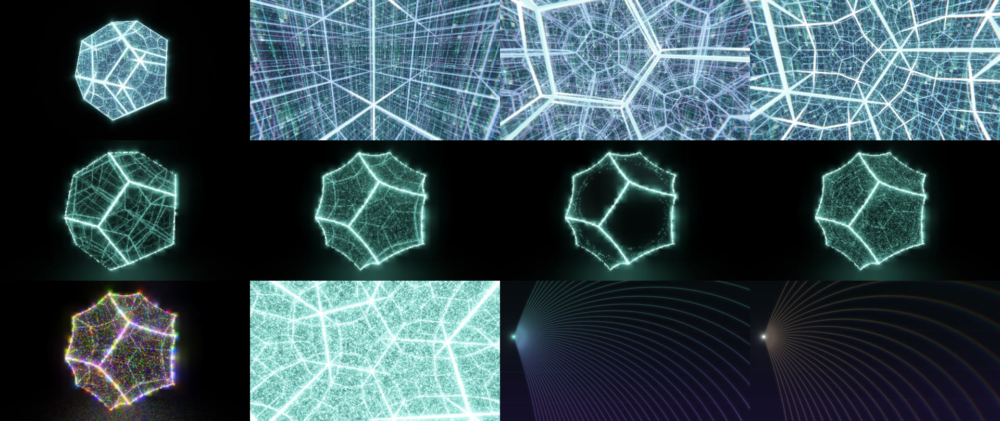
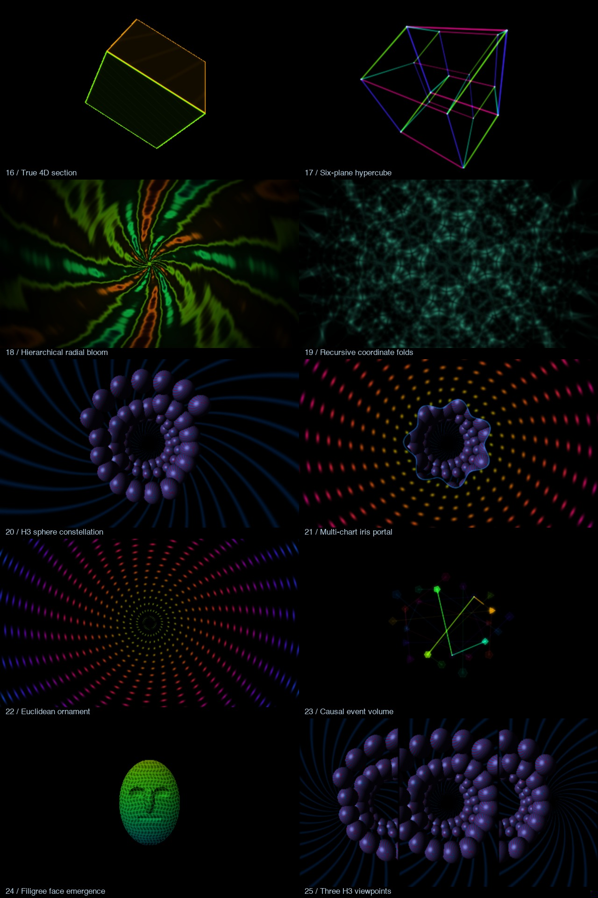
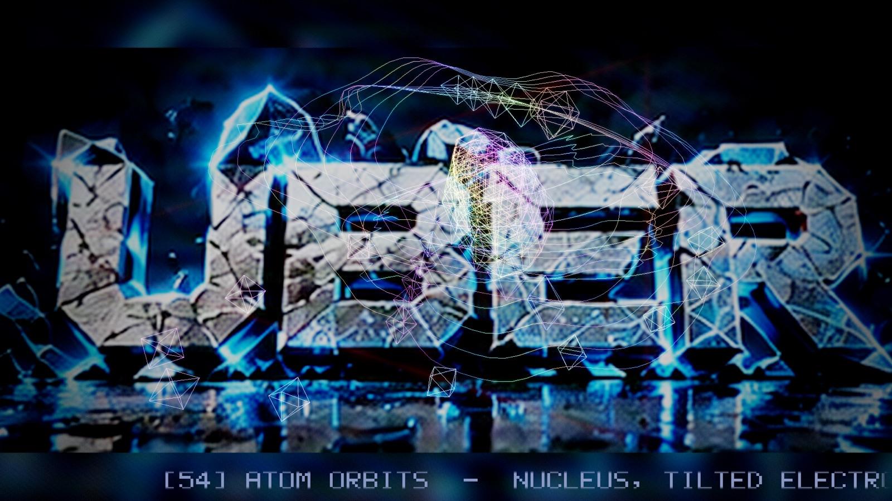
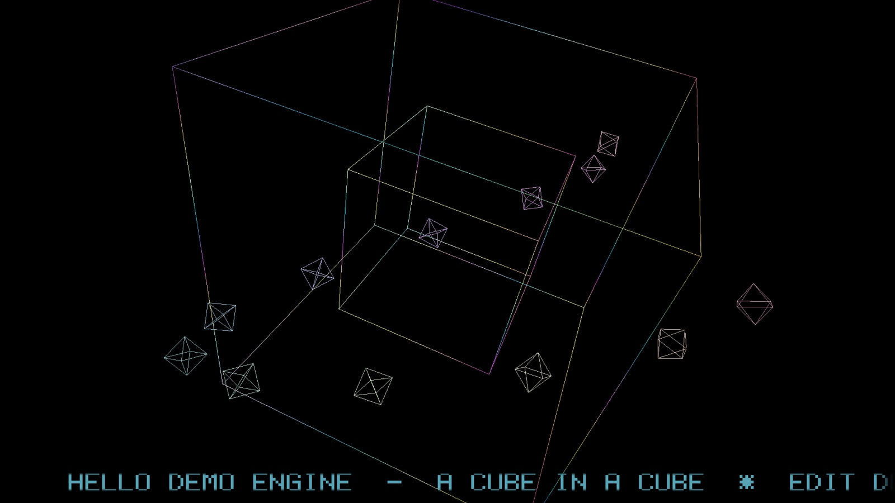

# Hold Infinity on Demo Engine

The default demo now ports **Hold Infinity**, supplied as `hold_infinity_by_purpletwilight21858029.zip`: mirrored dodecahedral chambers, hyperbolic honeycombs, spectral GRIN glass, a GPU gradient-index ray lab and the supplied parametric point-field study. Its 27 optical, Atlas and point-field scenes follow the soundtrack's beats, bars and frequency bands. The earlier effects are bypassed in this show. Normal playback adapts each scene’s resolution to GPU load; fixed-budget captures and still accumulation remain available.

```sh
make run
# or: ./build/hold_infinity --infinity-scene 3
```

[Controls, scene list, optical parameters and tests](demos/infinity/README.md) · [GPU optimization measurements](demos/infinity/GPU_PERFORMANCE.md) · [Source attribution](demos/infinity/SOURCE.md). `make run-wireframe` launches the previous demo.

The integrated [DMT Atlas](demos/atlas/README.md) adds exact 4D sections, six-plane hypercubes, seeded radial and folded fields, an accelerated H³ sphere renderer, iris portals, event glyphs, face emergence and three simultaneous viewpoints.





---

# Demo Engine



**A small, generic engine for real-time wireframe demos** in C++20 and OpenGL 4.1 Core (macOS, Linux and Windows). You write a class that produces a wire mesh every frame; the engine supplies everything else: window and GL context, an HDR render target with additive line blending, a post-processing chain, tracker-music playback with band analysis, tempo sync, a timed logo show, a beat-synced pixel-font ticker, screenshots and a full command line.

It was extracted from the [Impossible Wireframe](https://github.com/djayuffe/wireframe-scroller) demo, which is now just the first demo built on it.

Copyright (c) 2026 Ulf Bertilsson. MIT licensed. Engine version 1.6.0.

**Contents:** [Why](#why) | [Quick start](#quick-start) | [What the engine provides](#what-the-engine-provides) | [Writing a demo](#writing-a-demo) | [Demos in this repository](#demos-in-this-repository) | [Build](#build) | [Tests and CI](#tests-and-ci) | [Repository layout](#repository-layout) | [Roadmap](#roadmap)

Docs: [ARCHITECTURE.md](ARCHITECTURE.md) | [docs/WRITING_A_DEMO.md](docs/WRITING_A_DEMO.md) | [CHANGELOG.md](CHANGELOG.md)

Eight bundled tracks now span tracker/chiptune, melodic EDM, drum and bass, dark jazz and ambient synth.

Beat and music controls: [shared pulse/flash timing, playlists, presets and codecs](docs/MUSIC_AND_BEATS.md).

```sh
./build/hold_infinity --music-preset new --shuffle-seed 42 --beat-source hybrid
./build/impossible_wireframe --music-dir ~/Music/Demos --bpm 128 --beat-division 2
```

## Background styles

`--background-style auto|classic|synthwave|nebula|mandala|blackhole|hyperspace|fractal` picks the procedural background (key **V** cycles it live, **B** turns it off, **L** the logo cards). `auto` hands the choice to a director that listens to the music: it cuts on bar lines, reacts to drops and breakdowns with an early cut and a shockwave, and picks worlds that suit the energy (calm: nebula/black hole; peak: hyperspace/synthwave), sometimes with a sparser composition. `--fixed-step 0.0333` gives a deterministic clock for reproducible captures. `classic` is the slowly cross-fading generative blend; the others are single scenes: a striped-sun synthwave horizon with a neon grid, a parallax self-shadowed nebula with shooting stars, and a folded orbit-trap crystal mandala, and a relativistic black hole: ray-marched Schwarzschild lensing of a galaxy sky, a Doppler-beamed turbulent accretion disk, photon ring and polar jets, and a hyperspace warp tunnel with depth-shell star streaks you steer with the mouse, and a ray-marched fly-through of an infinite, twisting Menger-sponge cathedral lit by travelling light orbs. A styled background keeps its own palette (the post hue-drift grade is held back) and the final output is dithered to avoid banding.

Objects: every style is built from named objects; **F1-F12** switch the current style's objects on and off live (the list is printed when you press V or an F-key), and `--hide sun,grid,jets` starts with some off.

Interaction: move the mouse to steer the background (black hole: fly the camera; synthwave: steer; nebula: layer parallax; mandala: follow), click for a shockwave. Every layer sits at its own depth (five mote planes, each background layer, the wires as the middle plane) and a slow idle sway keeps it alive; `--parallax F` / **G** sets the effects-plane gain (wires, depth motes) and `--bg-parallax F` / **K** the background gain, independently (0 = flat, 3 = extreme). **D** toggles the independent depth-mote layer (also `--no-depth`). Background (**B**), logos (**L**), depth (**D**) and style (**V**) are all independent switches.

## Why
Every demo needs the same plumbing: a window, a float framebuffer, bloom and tone mapping, audio, a beat clock, a ticker, a screenshot switch for CI. The engine owns that plumbing so a new demo is one file that answers a single question: *what should be on screen right now?*

## Quick start
```sh
brew install cmake glfw sdl2 libopenmpt   # macOS; SDL2 + libopenmpt are optional (music)
./build_mac.sh --run                       # or: one command that installs deps, builds, tests and runs
make run-hello                            # the minimal demo
make run                                  # the native optical and Atlas demo
```

### Start every version

Run these from the repository root after `make`. Each `make run-*` command also
builds first, so it is safe to use directly after cloning.

```sh
make run                  # Hold Infinity: optical 0-15, GPU Atlas 16-25, point field 26
make run-atlas            # Hold Infinity opened directly on GPU Atlas scene 16
make run-aviation         # supplied parametric 3D point effect, native GPU scene 26
make run-wireframe        # Impossible Wireframe show
make run-hello            # minimal engine example
make run-ripple           # adaptive GPU-tessellation example
make run-atlas-reference  # CPU Atlas four-panel image -> build/atlas-reference.ppm
make run-atlas-advanced   # CPU Atlas advanced image -> build/atlas-advanced.ppm
```

Any live Atlas scene can be selected directly:

```sh
./build/hold_infinity --infinity-scene 16  # first Atlas scene
./build/hold_infinity --infinity-scene 25  # final Atlas scene
./build/hold_infinity --infinity-scene 26  # spectral parametric point field
./build/hold_infinity --infinity-scene 21 --atlas-reduced-motion
```

Press **Left/Right** to change scenes, **P** to pause Atlas motion and **Q** or
**Escape** to quit. Full Atlas controls and the scene matrix are in
[`demos/atlas/README.md`](demos/atlas/README.md).

GPU geometry: [adaptive tessellation, 23 offloaded effects, instanced copies, HDR and validation](docs/GPU_RENDERING.md).
On Metal-backed OpenGL, the engine automatically bypasses geometry-shader expansion
for compatible wires; use `--gpu-info` to inspect the selected path and live limits.

## What the engine provides
| Feature | What you get | Where |
|---|---|---|
| **Run loop** | Window, GL 4.1 core context (vsynced), clean Ctrl-C shutdown, minimise handling, `--frames N` exit for automation, `--stats` frame-time readout | `engine/src/Engine.cpp` |
| **HDR pipeline** | RGBA16F target, additive GL_ONE/GL_ONE lines so overlaps glow, depth-sorted travellers, `--quality` render scale | `engine/src/Renderer.cpp` |
| **Post pass** | A half-resolution art pass (procedural background, skipped while a logo covers the screen) plus bloom, chromatic aberration, lensing, glitch, grain, vignette, ACES tone map, plus a procedural art background and wild warps. `Config::fxAmount` dials the whole look from 1 (full) to 0 (clean wires) | `engine/shaders/post.frag` |
| **Logo show** | Optional 1920x1080 cards on a time-driven fade-in, hold, fade-out and black-break cycle | `Renderer::drawBackground` |
| **Audio** | libopenmpt module and SDL WAV playback, bass/mid/treble band split, level, row/pattern; the beat clock locks to the module's own tempo; falls back to a BPM clock | `engine/src/Audio.cpp` |
| **Timeline** | Beat, bar, phase and pulse from seconds and BPM | `engine/src/Timeline.cpp` |
| **Ticker** | Beat-synced 5x7 pixel-font band, toggled with T | `engine/src/TextScroller.cpp`, `shaders/scroller.frag` |
| **Effects library** | 80 CPU vertex warpers (including 16 "unknown" 4D, hyperbolic, attractor and growth effects), 30 curated recipes, deterministic mutation, a 60,000-edge budget, fast sort-based duplicate removal, undo on failure | `engine/src/Effects.cpp` |
| **Geometry kit** | `Mesh3`/`Polytope4`, cube, sphere, torus, 4D polytopes and projection, validation | `engine/src/Geometry.cpp` |
| **Wire styles** | `Frame::wireStyle`: 0 = electric palette, 1 = golden glimmer (additive point-cloud accumulation, gold twinkle and cross glints, warps and grading off) | `wire.frag`, `post.frag` |
| **Input** | Per-frame key state with rising-edge `pressed()` | `de::Input` |
| **CLI** | `--bpm --music --logos --window --fullscreen --quality --no-post --no-ticker --screenshot --frames --version --help`, extendable by the demo | `Engine.cpp` |
| **Asset search** | Config-relative paths resolved from the CWD, the executable directory and every ancestor | `Engine.cpp` |

## Writing a demo
A complete demo:
```cpp
#include "Engine.hpp"

struct MyDemo : de::Demo {
  const std::shared_ptr<const Mesh3> base = std::make_shared<const Mesh3>(geo::torus(96, 32, 1.f, .35f));
  de::Config config() const override {
    de::Config c; c.title = "My Demo"; c.version = "1.0"; c.binaryName = "ripple_demo";
    c.fxAmount = 0.4f;                                         // dial the post look down so the torus stays readable
    return c;
  }
  bool update(const de::FrameInfo& f, const de::Input& in, de::Frame& out) override {
    out.retainedMesh = base;
    out.revision = 1;                                      // upload the static mesh once
    out.gpuWave[0] = .2f;                                  // vertex shader animates the ripple
    out.scale = 1.f + .1f * f.sync.pulse;                      // pulse on the beat
    out.ticker = "MY DEMO  -  a torus that ripples";
    return !in.pressed(de::Key::Q);                            // Q ends the demo
  }
};
int main(int argc, char** argv) { MyDemo d; return de::run(d, argc, argv); }
```
This exact code is `demos/ripple/main.cpp`. Register a demo with one line in `CMakeLists.txt` (`de_add_demo(my_demo demos/my/main.cpp)`). The full guide, covering configuration, assets, custom options, effects and shaders, is [docs/WRITING_A_DEMO.md](docs/WRITING_A_DEMO.md).

## Demos in this repository
| Demo | Binary | What it shows |
|---|---|---|
| [`demos/hello`](demos/hello/main.cpp) | `hello_demo` | The minimum: a tumbling cube-in-cube with the ticker, FX off. About 40 lines |
| [`demos/ripple`](demos/ripple/main.cpp) | `ripple_demo` | The README example above, compiled as a real demo so the docs cannot drift |
| [`demos/wireframe`](demos/wireframe/README.md) | `impossible_wireframe` | The flagship: 57 mathematical objects, effect recipes, logo show, art background. Uses almost every engine feature, including the golden glimmer orbit clouds ported from uber256-lab |
| [`demos/infinity`](demos/infinity/README.md) | `hold_infinity` | Native optical scenes 0-15, GPU Atlas scenes 16-25 and the spectral point field at 26 |
| [`demos/atlas`](demos/atlas/README.md) | `atlas_render`, `atlas_advanced` | Standalone CPU reference renderers that write PPM images |



## Build
The build system is CMake. A `Makefile` wraps it for convenience — the
simplest path is just:

```sh
make            # configure (if needed) + build (Release, parallel)
make test       # build + run the geometry/scroller tests
make run        # build + launch Hold Infinity (optical + Atlas show)
make run-atlas  # launch directly into the live GPU Atlas
make run-hello  # launch the minimal hello demo
make run-ripple # launch the adaptive tessellation demo
make run-pulse  # Hold Infinity with the CC0 Wireframe Pulse track
make diag       # dump the resolved toolchain (SDK, GLFW, SDL2, openmpt)
make clean      # remove the build/ directory
make reconfigure# wipe build/ and reconfigure (recover from a stale cache)
```

The Makefile auto-reconfigures when `CMakeLists.txt` or the build type changes
(a stamp file tracks this), so a stale cache rarely needs manual cleanup. To
pin a specific macOS SDK or enable strict warnings:

```sh
make reconfigure CMAKE_EXTRA=-DIW_SYSROOT=$(xcrun --show-sdk-path)
make CMAKE_EXTRA=-DIW_WARNINGS_AS_ERRORS=ON
```

Or use CMake directly (macOS via Homebrew):

```sh
brew install cmake glfw
cmake -S . -B build -DCMAKE_BUILD_TYPE=Release
cmake --build build -j
ctest --test-dir build --output-on-failure
./build/impossible_wireframe --bpm 132
./build/hello_demo
```

Optional audio playback (libopenmpt + SDL2) is detected automatically; on
macOS add `brew install sdl2 libopenmpt`. Linux: install a C++20 compiler,
CMake, OpenGL development headers and GLFW3 development package, then use the
same commands (or `make`).

> **macOS build notes**
> - If you hit `No rule to make target '.../MacOSX.sdk/System/Library/Frameworks/OpenGL.framework'`,
>   your `build/` was configured against an SDK path that no longer exists (stale
>   CMakeCache). Just run `make reconfigure` (it wipes `build/` and reconfigures) —
>   the Makefile's `configure` target does this automatically now.
> - If you hit `tapi error: malformed file .../libSystem.B.tbd ... unknown
>   architecture` (or `OpenGL.tbd`, `libc++.tbd`) — even during CMake's compiler
>   check — your active `ld` can't parse the selected SDK's `.tbd` stubs. This
>   is usually a stale/mismatched CLT SDK (a removed CLT install, or a CLT
>   newer than the installed Xcode/ld). Fix: `make reconfigure` (CMakeLists now
>   pins `CMAKE_OSX_SYSROOT` to `xcrun --show-sdk-path` and `CMAKE_OSX_ARCHITECTURES`
>   to the host arch before `project()`). If a different SDK is needed:
>   `make reconfigure CMAKE_EXTRA=-DIW_SYSROOT=$(xcrun --show-sdk-path)`. As a
>   last resort, align the toolchain: `sudo xcode-select -s /Library/Developer/CommandLineTools`
>   (or an Xcode path) so the ld and SDK come from the same install.
> - On Apple the project links a real `libOpenGL.dylib` when available, else
>   `-framework OpenGL` (never the `OpenGL::GL` SDK-baked path), and adds the
>   OpenGL include dir so `<OpenGL/gl3.h>` resolves without relying on
>   toolchain-default SDK search.

If OpenGL/GLFW are absent, CMake still builds `iw_geometry` and `geometry_tests`, allowing headless CI validation.

## Tests and CI
`make test` builds and runs `geometry_tests` (about 8 s): canonical polytope counts, validity of every wireframe scene and every effect recipe, timeline math, window parsing, scroller buffer limits and shader conventions. Targets compile with `-Wall -Wextra -Wpedantic -Werror` (`/W4 /WX` on MSVC) when `IW_WARNINGS_AS_ERRORS=ON`. GitHub Actions builds and tests on macOS 15, Ubuntu 24.04 and Windows 2022. On Windows an in-tree OpenGL loader (`engine/include/GLWin32.hpp`) fetches the GL 4.1 functions through `glfwGetProcAddress`, because `opengl32.dll` only exports GL 1.1. The identical loader builds and passes tests in the public [wireframe-scroller](https://github.com/djayuffe/wireframe-scroller) CI; this private repo's own CI is currently blocked by the GitHub account's billing limit, and the engine has not been run on a physical Windows machine yet.

## Repository layout
| Path | Contents |
|---|---|
| `engine/include`, `engine/src` | The engine: `Engine`, `Renderer`, `Audio`, `Timeline`, `TextScroller`, `Effects`, `Geometry`, `Image`, `WindowSpec` |
| `engine/shaders` | GLSL 4.10 for wires, logo background, travellers, ticker and the post pass |
| `demos/hello` | Minimal demo |
| `demos/wireframe` | Flagship demo with its own scenes, assets, docs |
| `tests/` | `geometry_tests.cpp` |
| `thirdparty/` | `stb_image`, `stb_image_write` |
| `docs/` | Guides and README images |

## Roadmap
- Run and verify on physical Windows hardware.
- Per-demo shader overrides beyond `Config::shaderDir` (partial post chains).
- Mesh colours and per-edge attributes.
- Multiple meshes and instancing per frame.
- A scripting layer for scene lists.

### On-screen controls

Press **H** for a responsive controls card, including the current demo’s scene controls.
**I** shows playback, track credits, tempo source, beat settings and display resolution.
**J** cycles hybrid → audio → clock beat response. Playback, volume and beat switches
show brief confirmation cards; a startup hint fades away after seven seconds.
Use `--hud` or `--help-overlay` to open a card at launch, and `--no-hints` to hide
the startup hint. Automated frame captures stay clear unless a card is explicitly requested.
