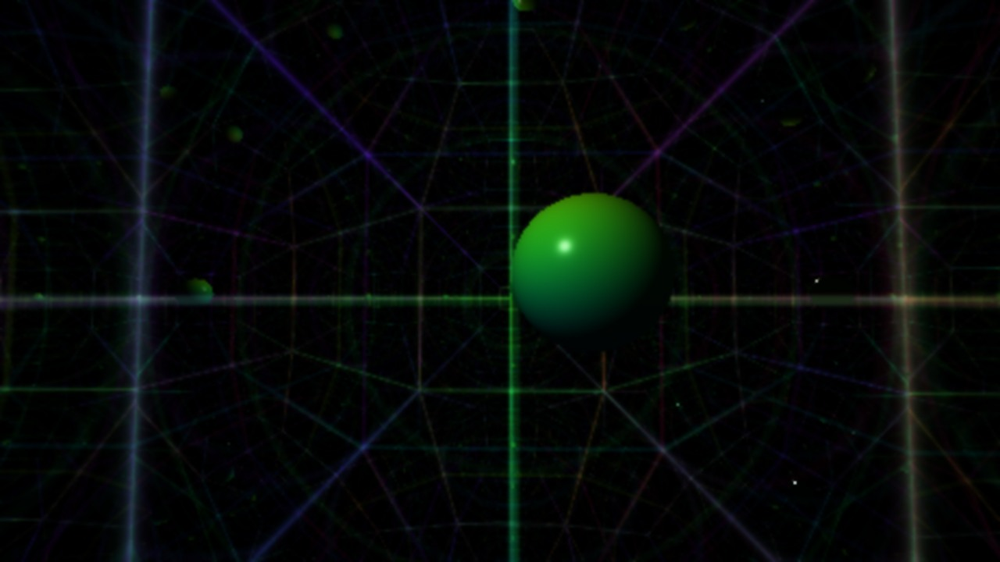

# DMT Atlas — native Demo Engine integration

The user-supplied `dmt_atlas_v03_gap_closure.zip` is integrated into the live OpenGL 4.1 show. Its executable archive features remain available as CPU reference tools. Eight nonfigurative Atlas studies occupy scenes 16–23, with the mirror gallery at 30. Slot 24 now contains the Möbius universe. The three-view scene at 25 is skipped by playback and remains available through explicit CLI selection for archival comparison. These are procedural geometry studies, without claims about reproducing subjective perception.

```sh
cmake -S . -B build -DCMAKE_BUILD_TYPE=Release
cmake --build build -j
./build/hold_infinity --infinity-scene 16
./build/hold_infinity --infinity-scene 21 --atlas-reduced-motion
./build/hold_infinity --infinity-scene 23 --atlas-flash-gain 0.3
```

Left/right select scenes; Space resumes the 32-beat automatic director. Drag to orbit; pointer movement supplies camera parallax. P pauses Atlas animation and holds the current Atlas scene; P resumes animation, and Space resumes automatic scene selection. Music continues during a visual pause. Playback still starts with Digital Rendezvous, the second playlist song.

`--atlas-reduced-motion` slows Atlas motion to 12% and suppresses its beat flashes and automatic camera dolly. `--atlas-flash-gain 0..1` scales the modest beat accents. `--atlas-exposure 0..2` caps linear Atlas exposure before the existing hue-preserving display shoulder. `--atlas-paused` starts with frozen Atlas animation. These controls apply to scenes 16–23, 25 and 30; they do not change the other scenes. Interactive camera movement remains available.

## Live scenes and archive coverage

| Scene | Implementation |
|---|---|
| 13 | Existing regular {7,3} Poincaré geodesic reflection tiling; the archive's polygon BFS is also retained in `atlas_render` |
| 16 | True tesseract section: restrict all eight cubic-cell halfspaces to an arbitrary 3D hyperplane, compose all six rotation planes, intersect the resulting convex solid per pixel |
| 17 | All 16 vertices and 32 edges, six-plane 4D rotation, edge clipping before 4D perspective projection, then ordinary 3D camera rays |
| 18 | Nine levels of the archive's radial hierarchy, exact CPU `childSeed` phases, logarithmic radius, projected-footprint detail filtering |
| 19 | Seven recursive coordinate folds, with footprint filtering and black-background HDR contours |
| 20 | All 56 source H³ geodesic spheres, analytic intersections, a general displaced Lorentz camera and proper tangent-space normals |
| 21 | Source sevenfold iris aperture, Euclidean ornament outside and H³ scene inside |
| 22 | Source standalone Euclidean ornament mode |
| 23 | Added authored event graph: 24 position/time nodes, four-unit durations, parent links, depth as a time axis and a 3–6-sided procedural glyph grammar |
| 24 | Added face emergence: ellipsoid head, bilateral eye sockets, nose and mouth landmark fields, filigree and phrase-driven visibility |
| 25 | Archived three independent displaced H³ viewpoints; skipped by automatic and keyboard playback |
| 30 | Lorentz mirror gallery: exact geodesic planes, six reflected segments and intrinsic H² wall markings |

The palette, contrast, lighting and animation adapt the references to the existing music-directed show. CPU PPM output remains available for inspecting the original compositions.


## Geometry and rendering details

`include/geometry.hpp` and `include/advanced.hpp` retain the archive API, adding finite/domain checks, stable disk distance, a stable near intersection root and arbitrary-direction camera tangent transport. Atlas uses **time first**, with Lorentz metric `(-,+,+,+)`; the earlier optical module uses its own convention. Do not interchange their four-vectors.

`include/Slice.hpp` restricts eight rotated halfspaces to an orthonormal slice basis. Coincident cubic cells do not generate duplicate polygons. The topology path enumerates valid triple-plane vertices for testing; the live path uploads only the eight planes when the section crosses the tesseract's inscribed unit ball. Surface entry, exit and edges are evaluated on the GPU. Tests cover central cubes, diagonal octahedra, coincident cells, empty cuts and 250 rotating convex sections with Euler characteristic two.

`include/HyperAtlas.hpp` builds a 111-node stackless hierarchy of **hyperbolic bounding balls**, not Euclidean boxes applied to warped geometry. Parent centers lie on the geodesic between child centers; radii enclose both children. The GPU reconstructs time coordinates, tests bounds, then intersects leaves. A generic shader with linear 56-sphere traversal remains accessible through `--infinity-reference`. CPU tests compare 12,000 general-camera rays against brute force and verify descendant containment.

Sphere normals are tangent to the hyperboloid at the hit. Both the normal and viewing direction are transported to the hit point's local rest frame for lighting. This replaces the source renderer's approximate Poincaré-coordinate normal.

All Atlas scenes render to RGBA16F. Each scene now shares a procedural celestial background with two filtered star populations, temperature variation, parallax, a folded nebula veil and restrained beat-wave light. A separate two-target HDR history pass applies frame-time-dependent, neighborhood-clamped exponential filtering. It resets on scene changes, resize, orbit dragging, still mode and pause, and never samples uninitialized history. It is temporal smoothing, not motion-vector reprojection or an infinite-detail reconstruction. The existing final shoulder preserves saturated highlights below white. Source hierarchy seeds never depend on frame number or camera position.

## Reference tools

```sh
./build/demos/atlas/atlas_render build/atlas.ppm 0.9 480
./build/demos/atlas/atlas_advanced build/portal.ppm 640 0.8 0
# advanced mode: 0 portal, 1 H3 only, 2 ornament only
ctest --test-dir build --output-on-failure
python3 tools/validate_atlas.py
python3 tools/validate_infinity.py
python3 tools/benchmark_infinity.py --scenes 16,17,18,19,20,21,22,23,24,25
```

The two reference executables include the preserved source through small build wrappers and use the hardened API. The wrapper supplies the original atlas renderer's missing `<bit>` include. Reference assertions remain enabled in Release builds. `source.json` records SHA-256 hashes for every original file; `validate_atlas.py` verifies them before native checks.

## Roadmap boundaries

The archive contains executable code **and an open research roadmap**. The executable features above are integrated. Concrete additional gaps closed here include GPU rendering, HDR history, audio timing, general H³ camera transport, H³ acceleration, correct tangent normals, robust slice degeneracies, event graphs, glyphs, face landmarks and multiple viewpoints.

The following roadmap topics remain outside this implementation and are not represented as completed:

- The preserved tiling BFS uses quantized centroid deduplication. The live disk renderer folds reflection domains; neither supplies canonical Coxeter group words or a persistent exact combinatorial cell database.
- H³ scene primitives include geodesic spheres and planes. There is no general arbitrary-surface H³ mesher/intersector.
- The portal is the archive's image-space chart composite, not a smooth metric-preserving transition between spaces of different curvature.
- The archive names a “21-system registry” without specifying its systems or interfaces. The actual scene registry is the engine's 31 named scenes; no unsupported registry is invented.
- Face recognizability, perceptual equivalence, VR navigation and human studies have not been validated. RGB rendering cannot create additional spectral primaries or genuinely infinite detail.

## Provenance

See [SOURCE.md](SOURCE.md) for preserved files and source status. Original archive documentation in `reference/` is retained as reference material; its roadmap is not silently converted into scientific or implementation claims.

## 4.1 rendering refinements

Atlas now adds geometry breathing, conservative animated sphere bounds, exact H³ shadow rays and GGX shading, actual relief intersections for scenes 18/19/22, projected material filtering and causally timed event packets. The face marcher rejects rays outside an enclosing sphere and evaluates material footprints without divergent screen derivatives. Shared HDR highlight processing also benefits the earlier optical scenes. See the [rendering controls and implementation notes](../infinity/README.md#rendering-refinement-41).

## 4.3 GPU geometry and 3D expansion

The 5,376-byte `std140` Atlas geometry block stores immutable hyperboloid centers, conservative hierarchy bounds and sphere-radius coefficients. It is uploaded once and shared across programs. Runtime layout and device-limit checks guard CPU/GPU agreement. The cached radius update uses the hyperbolic addition identities with a bounded polynomial remainder below float rounding, avoiding repeated exponential evaluation at each ray intersection. `--atlas-uncached` restores per-ray reconstruction while retaining the same BVH and shading for isolated comparisons.

The hypercube projects its sixteen corners in the vertex stage and packs them into 48 flat varying components. Its bounded 4D extent keeps every corner ahead of the 4D eye plane. A separate `--atlas-edge-raster` backend uses 32 GPU instances and geometry-shader quads bounded conservatively around each projected edge. It preserves the same analytic ray/segment shading and exposure controls, with a very faint tail cutoff at 0.28 world units. This backend is **opt-in**: measured geometry-stage overhead exceeded its savings at the tested budget on the M1 Pro. Shader failure falls back to the regular ray-distance path.

Scene 30 extends the geometry API with exact geodesic-plane intersection and Lorentz-plane reflection. The gallery follows six reflected geodesic segments inside a compact six-wall chamber, shading a contained sphere and markings measured in each wall's induced H² chart. Reflection tangents are reprojected to contain floating-point drift. This is a bounded six-bounce rendering, not an infinite path sum or a general arbitrary-surface solver.

```sh
./build/hold_infinity --infinity-scene 30
./build/hold_infinity --infinity-scene 17 --atlas-edge-raster
python3 tools/benchmark_infinity.py --atlas-cache-only --scenes 17,20,21,25
```


