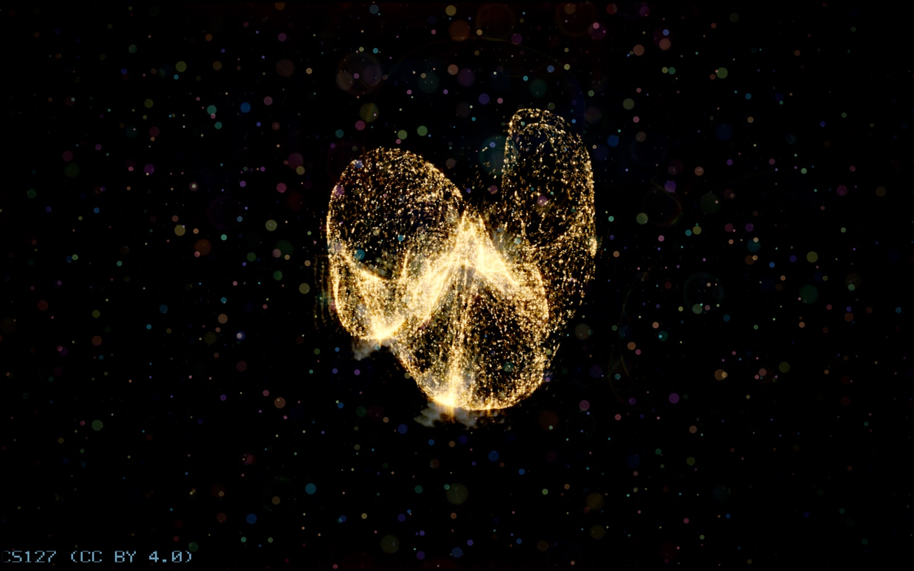
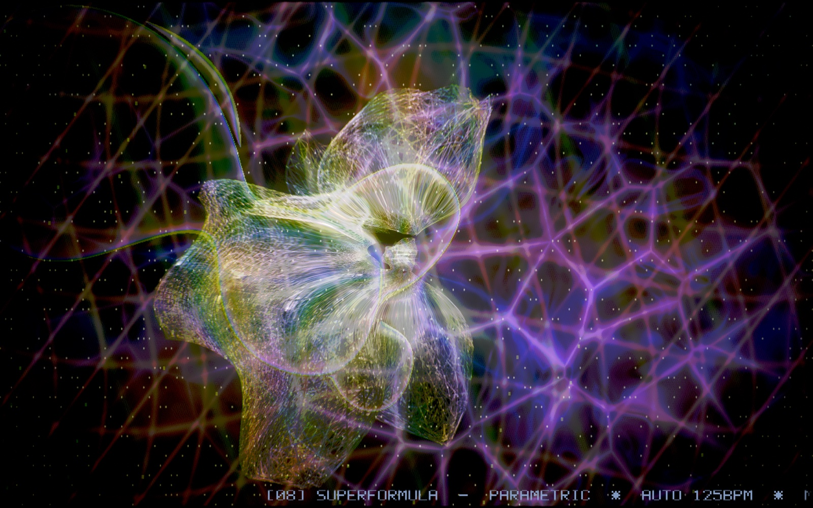

# Screenshot gallery

These are captures from the native application, not concept art. Local captures retain their original composition and credit ticker; the two gallery copies are resized JPEGs for practical repository browsing.

## Golden particle sculpture



Captured 24 October 2026. Source: `demo-20261024-211235.png` (2880 × 1800); gallery copy 1600 × 1000. The visible ticker credits cs127 (CC BY 4.0).

## Parametric wire sculpture



Captured 24 October 2026. Source: `demo-20261024-203901.png` (2880 × 1800); gallery copy 1600 × 1000. This is a capture of the wireframe show's superformula scene.

## Lorentz mirror gallery — scene 30


A native capture of the six-wall hyperbolic mirror study.

## Optical and Atlas scene sheets


The contact sheets document earlier scene sets; use the current [scene guide](../demos/infinity/README.md) for the active mapping.

## Capture your own

```sh
./build/hold_infinity --infinity-scene 30 --frames 120 --fixed-step 0.0166667 --screenshot build/gallery.png
```

Use matching resolution, scene, time and options for comparisons. Captures vary with music and camera input. Source attribution and license boundaries are recorded in [LICENSES.md](../LICENSES.md).
